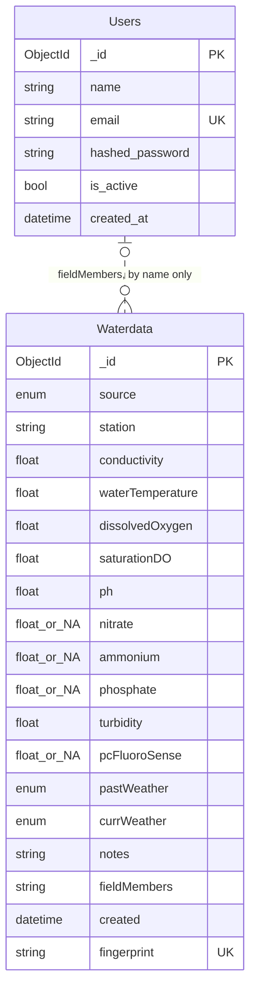

# Database Schema

MongoDB, database `waterstation` (tests use `waterstation_test`). Mongo doesn't
enforce a schema itself: the Beanie models in `model/` are the source of truth,
and this page should be updated in the same PR as any change to them.



Users and Waterdata are not linked yet: `fieldMembers` holds plain names. Once
the frontend has login, the uploader should be stored as a reference to Users.

## Users

Model: `model/Users.py`

| Field | Type | Rules |
|---|---|---|
| `_id` | ObjectId | set by Mongo |
| `name` | string | required |
| `email` | string | valid email, stored lowercase, **unique index** |
| `hashed_password` | string | bcrypt hash, never the password itself |
| `is_active` | bool | default `true`; inactive users can't use a token |
| `created_at` | datetime (UTC) | set by the server |

## Waterdata

Model: `model/waterdata.py`. One document per sensor reading.

| Field | Type | Rules |
|---|---|---|
| `_id` | ObjectId | set by Mongo |
| `source` | enum `Waterbody` | one of the 12 waterbodies below |
| `station` | string | 1-100 chars |
| `conductivity` | float | >= 0 |
| `waterTemperature` | float | |
| `dissolvedOxygen` | float | >= 0 |
| `saturationDO` | float | >= 0 |
| `ph` | float | 0-14 |
| `nitrate` | float or `"N/A"` | >= 0, default `"N/A"` |
| `ammonium` | float or `"N/A"` | >= 0, default `"N/A"` |
| `phosphate` | float or `"N/A"` | >= 0, default `"N/A"` |
| `turbidity` | float | >= 0 |
| `pcFluoroSense` | float or `"N/A"` | >= 0, default `"N/A"` |
| `pastWeather` | enum `WeatherConditions` | |
| `currWeather` | enum `WeatherConditions` | |
| `notes` | string | optional, max 2000 chars |
| `fieldMembers` | string | comma-separated names, 1-300 chars |
| `created` | datetime (UTC) | when the server stored it, not when the sample was taken |
| `fingerprint` | string | sha256 of the submitted reading, **unique index** (see below) |

`Waterbody`: Fletcher Lake, Deal Lake, Jackson Woods, Lake Como,
Lake Takanassee / Whale Pond Brook, Shadow Lake, Silver Lake, Spring Lake,
Sunset Lake, Sylvan Lake, Wesley Lake, Wreck Pond.

`WeatherConditions`: Storm (heavy rain), Rain (steady rain),
Showers (intermittent rain), Overcast, CLEAR/SUNNY.

## Indexes

| Collection | Index | Why |
|---|---|---|
| Users | `email`, unique | one account per email; fast login lookup |
| Waterdata | `fingerprint`, unique, partial (only where it's a string) | a retried upload returns the stored reading instead of a duplicate; partial so readings stored before this field existed are allowed |
| Waterdata | `created` desc, `_id` desc | `GET /waterdata` lists newest first with paging, without sorting the whole collection |

Beanie creates these on startup (`init_beanie` in `database.py`).

## Sample data

`seed.py` fills the database with fake readings across all 12 waterbodies,
spread over the last 90 days:

```bash
uv run python seed.py          # 60 readings
uv run python seed.py -n 200   # more
```

It uses a fixed random seed, so running it again adds nothing new. The values
follow the client's real data (next section): the form's dropdown steps, the
real spread of each measurement, and how often each test is skipped.

## Compared with the client's real data

Prof. Lakshmanan sent two files to model the database from: the CLOnet field
form definition (10/15) and a CSV export of the readings entered through it so
far (9/18). The CSV is not in this repo: it holds volunteers' names, emails and
IP addresses.

What the export holds: 2,491 field visits from May 2019 to Aug 2026, all 12
waterbodies (Deal Lake 692, Lake Como 390, Silver Lake 343, ... Fletcher Lake
27), at 39 named sampling sites.

| Measurement | Real range (1st-99th pct) | Skipped |
|---|---|---|
| Water temperature (C) | 3.4 - 32.2 | 0% |
| Conductivity (uS) | 2 - 7,390, median 301 | 3% |
| Dissolved oxygen (ppm) | 1 - 16 | 3% |
| % saturation DO | 11 - 175 | 6% |
| pH | 5.5 - 9.5 | 29% |
| Nitrate (ppm) | 0 - 7 | 99% |
| Ammonium (ppm) | 0 - 2 | 90% |
| Phosphate (ppm) | only 4 readings, all 10 | ~100% |
| Secchi depth (ft) | 0.25 - 3.4 | 13% |
| PC FluoroSense | 0 - 199 | 66% |
| Air temperature (F) | 30 - 91 | 2% |

Where our model differs from the real form. These are proposals: each one
changes the API the iOS app sends to, so they need the team's agreement.

| Form field | Our model | Gap |
|---|---|---|
| Date + Time (required) | none, `created` is upload time | the detail view must show when the sample was taken; data uploaded hours later gets the wrong date |
| Current Air Temp F (required) | missing | not stored at all |
| Weather in Past 24 Hours (checkboxes, several allowed) | one `WeatherConditions` value | can't store "Overcast + Showers" |
| "Clear/Sunny" | `"CLEAR/SUNNY"` | spelling differs, so real data won't import as is |
| Turbidity = Secchi depth in feet | `turbidity`, no unit | rename or document the unit |
| pH, conductivity, DO required | required | the real data skips pH 29% of the time; an import needs them optional |
| Station (free text) | `station` | real entries are messy ("East", "east", "East End"); the export also has a site code (`DLEE`, `Sil_W`, 39 of them) that would make a cleaner location |
| Submitted By + Email | `fieldMembers` names only | no link to a user yet |

Also missing compared with the team's requirements: a Devices collection (the
Device status screen), and phone number, units, notifications and auto-connect
on Users (Account settings).

## Known gaps

- No sample date/time or location: `created` is upload time.
- No device id for the station that took the reading.
- Skipped tests are the string `"N/A"` instead of `null`, which makes averages
  and charts harder.
- No reference from a reading to the user who uploaded it.
